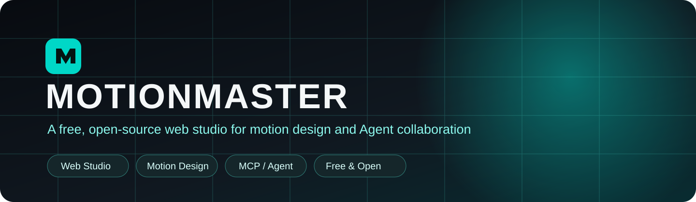
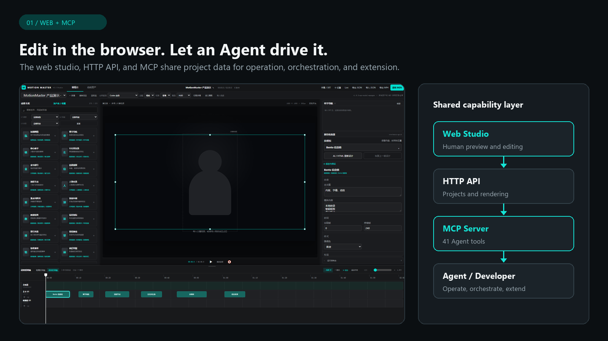
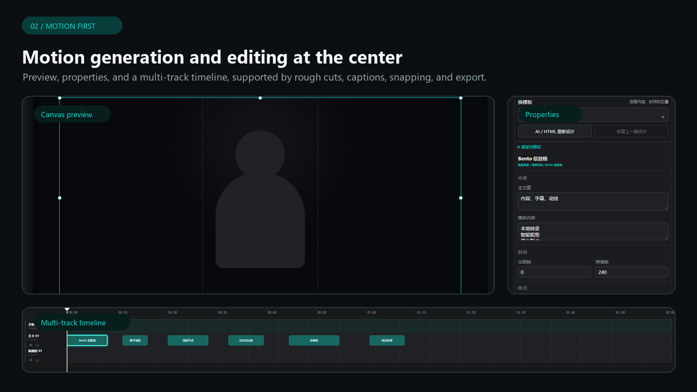
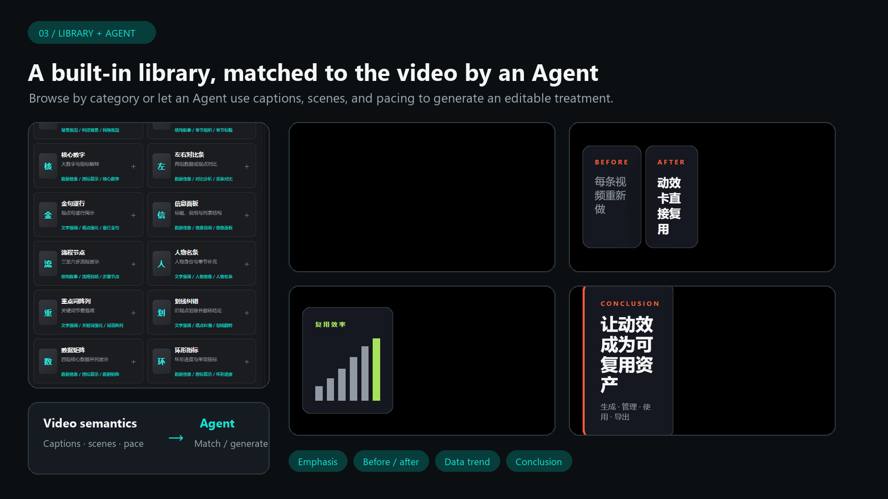
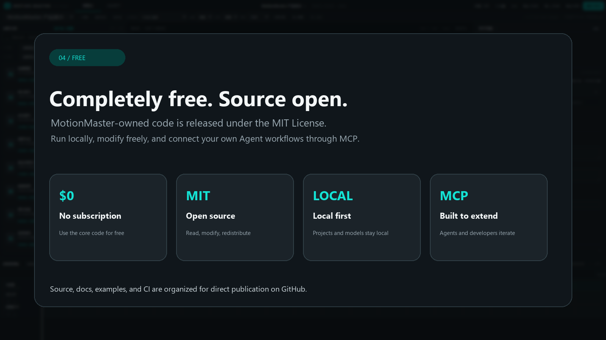
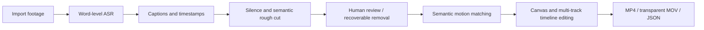
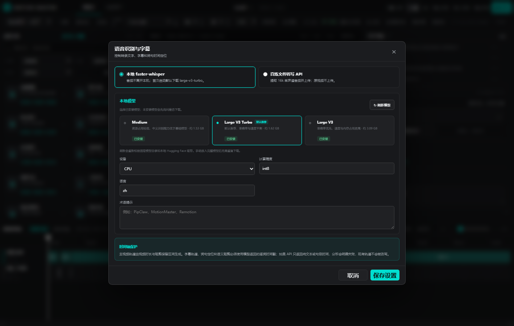
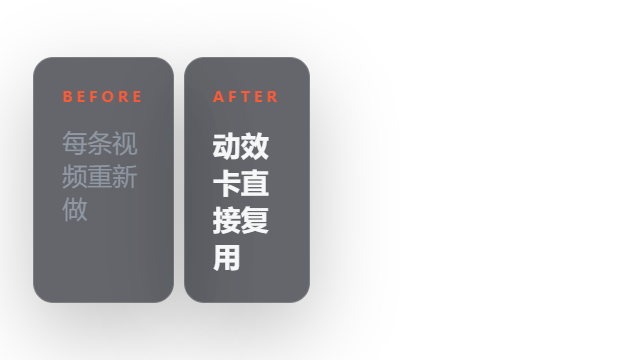
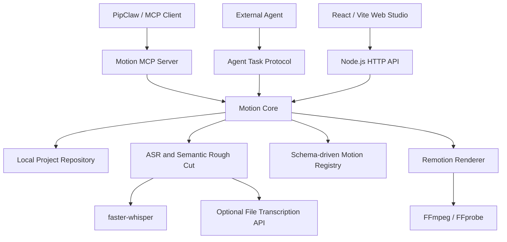

<p align="right">
  <strong>English</strong> · <a href="README.zh-CN.md">简体中文</a>
</p>

<p align="center">
  
</p>

<p align="center">
  <strong>A free, open-source web studio for motion design, editing, and Agent collaboration.</strong>
</p>

<p align="center">
  
  
  
  
</p>

MotionMaster is a completely free and open-source web application built primarily for generating and editing video motion graphics. It also includes practical video-editing features such as rough cutting, captions, splitting, and export. Its built-in motion library can be used directly by people or orchestrated by an Agent through MCP. An Agent can analyze a video, match or generate suitable motion treatments, edit the timeline, and extend the product itself through the source code.

> This repository contains source code, synthetic examples, and documentation only. It does not contain Whisper models, Python virtual environments, user projects, videos, captions, transcripts, or API keys.

## Four things to know

### 1. A web application that Agents can drive through MCP

People can edit directly in the browser. The web studio, HTTP API, and MCP Server share the same project data. Agents can create projects, analyze media, add and modify motion cards, operate the timeline, inspect results, trigger exports, and build further product capabilities on top of the same interfaces.



### 2. Motion generation and editing are the core

The workspace is organized around motion preview, template properties, and a multi-track timeline. Motion elements can be selected, moved, and resized on the canvas, then split, dragged, snapped, replaced, or batch-edited on the timeline. Rough cuts, captions, and audio handling complete the surrounding video workflow.



### 3. A built-in motion library, plus Agent-generated treatments

The built-in catalog provides three-level classification, search, preview, replacement, and parameter editing. An Agent can use captions, visual context, chapters, and pacing to choose varied templates, generate timing and content parameters, and return an editable result to the studio.



### 4. Completely free and open source

MotionMaster-owned code is released under the MIT License, with no software subscription fee. The repository includes source code, documentation, examples, and CI configuration, so it can be run locally, modified, and redistributed. Third-party components, models, and assets remain subject to their respective licenses.



## What it can do

| Area | Capability |
| --- | --- |
| Video projects | Import local video and persist canvas, theme, tracks, edits, and motion data |
| Speech recognition | Use local faster-whisper or configure a compatible asynchronous file-transcription API |
| Rough cutting | Generate keep/remove ranges from word timestamps, silence, and semantic analysis; removed material stays recoverable |
| Dual timelines | Use the rough-cut timeline to clean source footage and the motion timeline for captions, the main track, and layered motion |
| Motion library | Browse 275 catalog entries with three-level classification, search, preview, template replacement, and property editing |
| Interface languages | Switch between Simplified Chinese and English from the top-right toolbar without reloading; the preference persists locally |
| Visual editing | Select, move, and scale cards in the preview; move, split, snap, and multi-select items on the timeline |
| Export | Produce H.264 MP4, transparent ProRes 4444 MOV, JSON, and still images |
| Automation | Use the HTTP API, MCP, external Agent task protocol, and version-conflict protection |

The catalog contains 53 local core, HTML, and foundational entries plus 222 curated source-catalog entries. Some catalog entries share generic local renderers for discovery, preview, and future refinement; they do not represent 275 fully independent upstream component implementations.

## Workflow



Timeline timestamps always come from ASR or caption data. Switching recognition models changes the recognition source; it does not cause a language model to guess timeline positions.

The interface follows the browser language on first launch and can be switched at any time from the top-right language menu. Product controls, dialogs, timeline labels, asset classification, and ASR settings are localized; project names, imported captions, transcripts, and card copy stay exactly as authored. See [Interface languages](docs/I18N.md).

## Interface and motion examples

<table>
  <tr>
    <td width="50%"></td>
    <td width="50%"><strong>Model management</strong><br/>Detect and switch among medium, large-v3-turbo, and large-v3. Missing models are downloaded only after confirmation.</td>
  </tr>
</table>

| Emphasis | Before/after | Data trend | Conclusion |
| --- | --- | --- | --- |
|  |  |  |  |

## Architecture



### Code map

| Path | Contents |
| --- | --- |
| `apps/studio-web` | Web studio, projects, asset manager, settings, preview, and timeline interaction |
| `packages/motion-api` | HTTP API, project services, ASR settings, rough cuts, and Agent tasks |
| `packages/motion-core` | Project repository, edit plans, validation, scene arrangement, and version control |
| `packages/motion-schema` | Types for projects, cards, tracks, captions, ASR, and task protocols |
| `packages/semantic-cut` | Media analysis, word-level transcription, silence detection, time mapping, and rough-cut policies |
| `packages/motion-render` | Remotion compositions, rough-cut rendering, MP4, transparent MOV, and still images |
| `packages/motion-mcp` | MCP tools and resources |
| `card-packs/starter` | Core, extended, and HTML motion cards, classification, and render components |
| `card-packs/shotcraft-motion` | Deterministic motion-only card pack |
| `scripts` | Startup, diagnostics, ASR installation, tests, and packaging |
| `skills/video-motion-master` | Orchestration instructions for Skill-capable Agents |

## Quick start

### Requirements

- Windows 10 or 11
- Node.js 20 or newer
- Python 3.10–3.13
- Google Chrome
- At least 12 GB of free disk space; allow more when using `large-v3`

### One-command setup

```powershell
git clone https://github.com/YOUR_ACCOUNT/motion-master.git
cd motion-master
.\setup.ps1
.\start.bat
```

Open <http://127.0.0.1:4180>.

On first launch, MotionMaster creates `runtime/asr-env` and prepares `large-v3-turbo` by default. If the machine is temporarily offline, the studio can still start and the model can be downloaded later from Settings.

### Manual development

```powershell
npm ci
npm run dev
```

The frontend and API start from the same development command. Projects are stored under `projects/<project-id>` by default, and that directory is excluded from Git.

## ASR models

| Model | Approximate download | Suggested use |
| --- | ---: | --- |
| `medium` | 1.53 GB | Lower-resource machines and faster processing |
| `large-v3-turbo` | 1.62 GB | Default; balanced speed and accuracy |
| `large-v3` | 3.09 GB | Accuracy-first workflows with more resources |

Models are stored in `runtime/models` and are never committed to Git. **Refresh models** checks the fixed model directory, complete manually copied models, and the local Hugging Face cache. See the [Local ASR Model Guide](docs/LOCAL-ASR-MODEL-GUIDE.md) and [Runtime Dependencies](docs/RUNTIME-DEPENDENCIES.md).

## Data and privacy

- User videos, captions, transcripts, edit ledgers, and rendered output stay in the local project directory.
- Local ASR does not upload audio.
- Media is sent to a provider only when the user explicitly selects cloud file transcription and configures an API.
- API keys are stored in the local data directory and should never be committed to source code, examples, or Issues.
- Project writes use `expectedVersion` to prevent an Agent or another interface from overwriting newer human edits.

## API and MCP

After the service starts, these endpoints are available:

- `GET /api/system` — version and capabilities
- `GET /api/cards` — motion card registry
- `GET /api/projects` — local project list
- `GET /api/agent/protocol` — external Agent protocol

Generate an MCP configuration:

```powershell
powershell -ExecutionPolicy Bypass -File .\scripts\generate-mcp-config.ps1
```

See [Agent Integration](docs/agent-integration.md) for the protocol and security boundaries.

## Validation

```powershell
npm run build
npm test
npm run test:api
npm run test:mcp
npm run doctor
```

`doctor` checks Node, Chrome, FFmpeg, the ASR environment, and model status. A missing model produces guidance but does not block source builds or foundational tests.

## Contributing

Read [CONTRIBUTING.md](CONTRIBUTING.md) before contributing. Do not attach real videos, captions, project files, API keys, or other personal data to bug reports. Report security issues privately according to [SECURITY.md](SECURITY.md).

## License

MotionMaster-owned code is available under the [MIT License](LICENSE). Remotion, referenced template sources, fonts, FFmpeg, ASR runtimes, and model weights remain subject to their own licenses. See [THIRD_PARTY_NOTICES.md](THIRD_PARTY_NOTICES.md).
