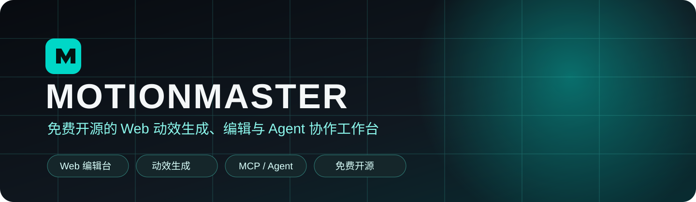
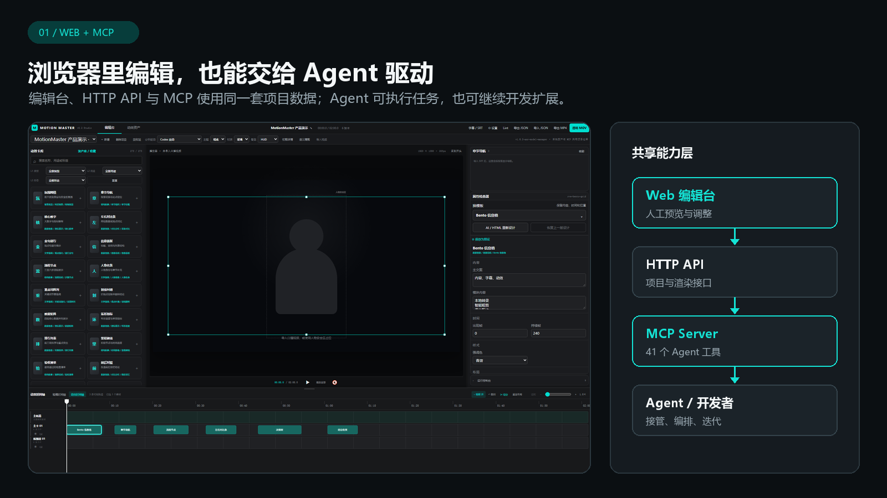
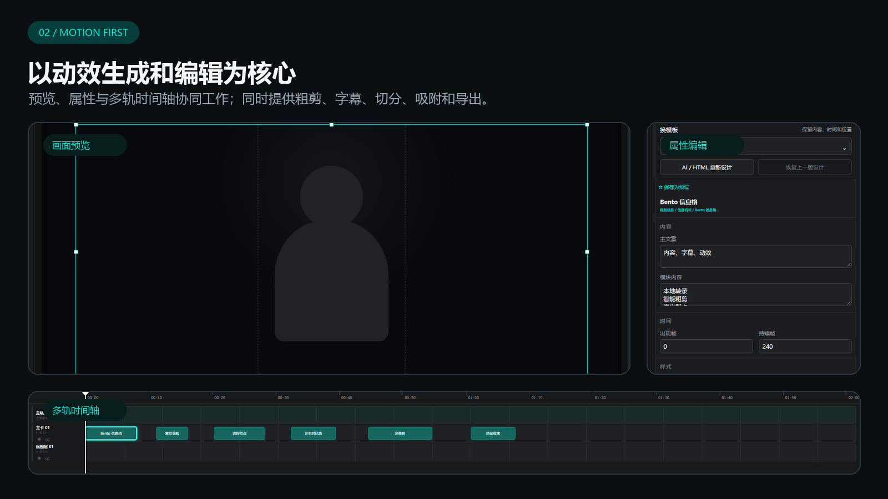
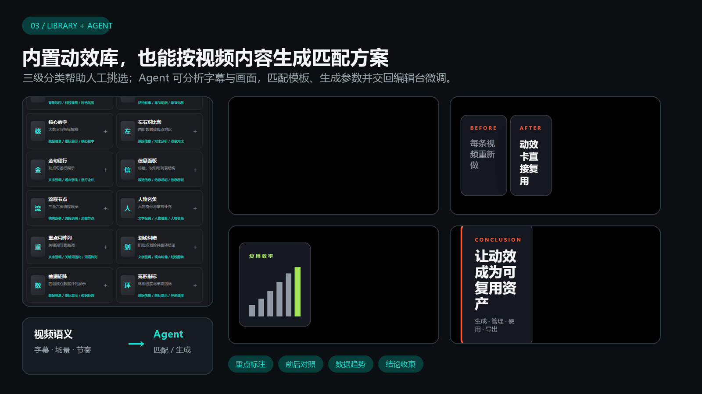
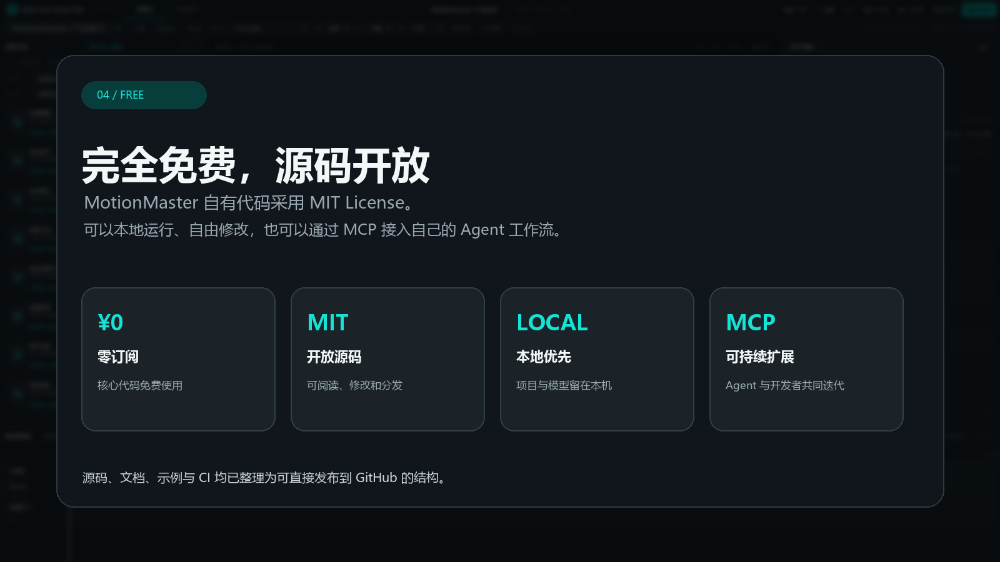
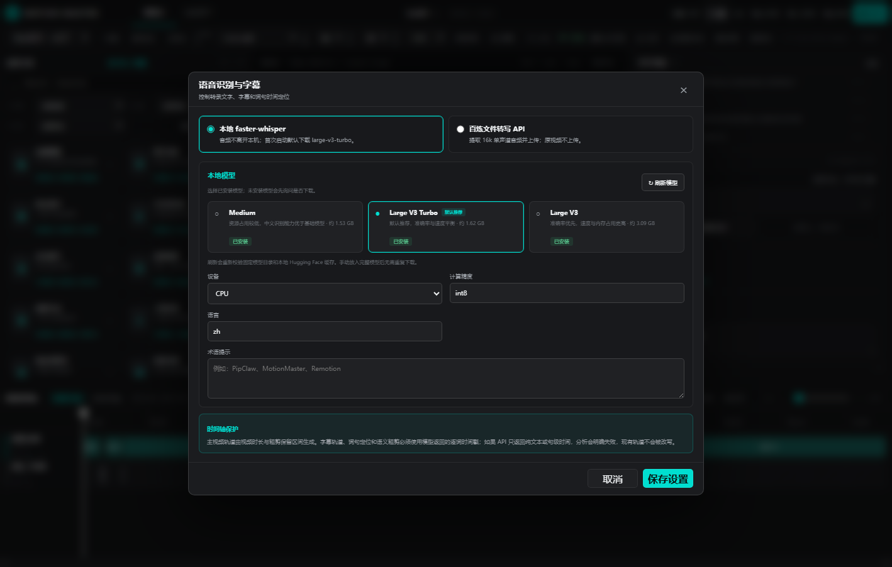
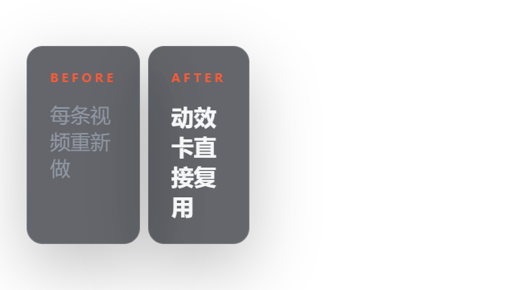
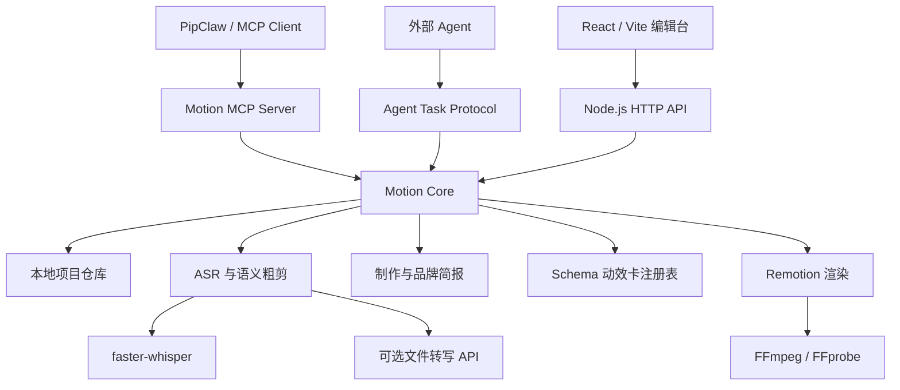

<p align="right">
  <a href="README.md">English</a> · <strong>简体中文</strong>
</p>

<p align="center">
  
</p>

<p align="center">
  <strong>免费开源的 Web 动效生成、编辑与 Agent 协作工作台。</strong>
</p>

<p align="center">
  
  
  
  
</p>

MotionMaster 是一款完全免费的开源 Web 应用，主要用于生成和编辑视频动效，并提供粗剪、字幕、切分和导出等常用视频剪辑能力。它内置可检索的动效库；Agent 既可以通过 MCP 接管编辑流程，也可以分析视频内容、匹配或生成更合适的动效，并在源码基础上继续开发。

> 本仓库只包含源码、示例和文档。它不包含 Whisper 模型、Python 虚拟环境、用户项目、视频、字幕、转录结果或 API Key。

## 四个产品重点

### 1. Web 应用，可由 Agent 通过 MCP 驱动

用户可以直接在浏览器中完成编辑。HTTP API、MCP Server 和 Web 编辑台共享项目数据，Agent 能创建项目、分析素材、添加和修改动效、操作时间轴、检查结果并触发导出。开发者也可以沿用这些接口继续迭代产品。



### 2. 动效生成和编辑是核心能力

编辑台围绕动效预览、模板属性和多轨时间轴组织。用户可以在画面中点选、移动和缩放动效，也可以在时间轴中切分、拖拽、吸附、换模板和批量处理。视频粗剪、字幕和音频处理用于支撑完整的视频制作流程。



### 3. 内置动效库，Agent 也能按内容生成方案

内置动效目录提供三级分类、搜索、预览和参数编辑。Agent 可以结合字幕、画面、章节和节奏选择不同类型的模板，生成时间位置与内容参数，再交给用户继续调整。



### 4. 完全免费、源码开放

MotionMaster 自有代码采用 MIT License，不收取软件订阅费用。源码、文档、示例和 CI 配置都包含在仓库中，可本地运行、自由修改和分发。第三方组件、模型与素材继续遵循各自的许可证。



## 能做什么

| 模块 | 作用 |
| --- | --- |
| 视频项目 | 导入本地视频，保存画布、主题、轨道、剪辑和动效数据 |
| 语音识别 | 使用本地 faster-whisper，或配置兼容的异步文件转写 API |
| 粗剪 | 根据逐词时间戳、静音和语义判断生成保留/删除区间，删除内容可恢复 |
| 双时间轴 | 粗稿时间轴用于清理原片；动效时间轴用于字幕、主轨道和多层动效 |
| 动效卡库 | 275 个注册条目，支持三级分类、搜索、预览、换模板和参数编辑 |
| 制作工作流 | 选择制作模式、叙事配方、目标画幅和可复用品牌档案；Agent 通过 MCP 读取同一份创作简报 |
| 界面语言 | 右上角可在简体中文与 English 之间即时切换，无需刷新，并在本机保存选择 |
| 画面编辑 | 在预览区点选、移动和缩放卡片；在时间轴移动、切分、吸附和批量选择 |
| 导出 | 输出 H.264 MP4、透明 ProRes 4444 MOV、JSON 和静帧 |
| 自动化 | API、MCP、外部 Agent 任务协议和版本冲突保护 |

卡库由 53 个本地核心/HTML/基础条目和 222 个整理后的来源目录条目组成。部分来源目录条目共享本地通用渲染器，用于检索、预览和后续深化；它们并不代表 275 套完全独立的上游组件实现。

## 工作流程


时间戳始终由 ASR 或字幕数据提供。更换识别模型只改变识别来源，不会把时间轴改成由语言模型猜测生成。

产品宣传片、功能发布、教程和数据报告可以在“设置”中保存项目制作档案。自动编排会收到对应的场景配方与品牌约束；质量检查会提示品牌资料缺失、对比度不足和模板形式重复。详见 [制作工作流](docs/PRODUCTION-WORKFLOW.md)。

首次启动时界面跟随浏览器语言，也可随时通过右上角语言菜单切换。产品控件、对话框、时间轴标签、资产分类和 ASR 设置均会切换语言；项目名称、导入字幕、转录文字和卡片文案保持用户原始内容。详见[界面语言说明](docs/I18N.md)。

## 界面与动效

<table>
  <tr>
    <td width="50%"></td>
    <td width="50%"><strong>模型管理</strong><br/>固定识别 medium、large-v3-turbo 和 large-v3；已安装模型可直接切换，缺失模型在确认后下载。</td>
  </tr>
</table>

| 重点标注 | 前后对照 | 数据趋势 | 结论收束 |
| --- | --- | --- | --- |
|  |  |  |  |

## 系统结构



### 代码地图

| 路径 | 内容 |
| --- | --- |
| `apps/studio-web` | 编辑台、项目页、资产页、设置页、预览和时间轴交互 |
| `packages/motion-api` | HTTP API、项目服务、ASR 设置、粗剪与 Agent 任务 |
| `packages/motion-core` | 项目仓库、编辑计划、校验、场景编排和版本控制 |
| `packages/motion-schema` | 项目、卡片、轨道、字幕、ASR 和任务协议类型 |
| `packages/semantic-cut` | 媒体分析、逐词转录、静音检测、时间映射和粗剪策略 |
| `packages/motion-render` | Remotion 合成、粗剪渲染、MP4、透明 MOV 和静帧 |
| `packages/motion-mcp` | MCP 工具与资源 |
| `card-packs/starter` | 基础卡、扩展卡、HTML 卡、分类与渲染组件 |
| `card-packs/shotcraft-motion` | 确定性纯动效卡包 |
| `scripts` | 启动、诊断、ASR 安装、测试与打包脚本 |
| `skills/video-motion-master` | 给支持 Skill 的 Agent 使用的编排说明 |

## 快速开始

### 环境

- Windows 10/11
- Node.js 20 或更高版本
- Python 3.10–3.13
- Google Chrome
- 至少 12 GB 可用磁盘空间；使用 `large-v3` 时建议更多

### 一键启动

```powershell
git clone https://github.com/TylabAI/motionmaster.git
cd motionmaster
.\setup.ps1
.\start.bat
```

浏览器打开：<http://127.0.0.1:4180>

首次启动会创建 `runtime/asr-env`，并默认准备 `large-v3-turbo`。如果暂时无法联网，编辑台仍会启动，可以稍后在设置页下载模型。

### 手动开发

```powershell
npm ci
npm run dev
```

前端和 API 由同一开发命令启动。项目默认保存在 `projects/<project-id>`；该目录已被 Git 忽略。

## ASR 模型

| 模型 | 约下载体积 | 使用建议 |
| --- | ---: | --- |
| `medium` | 1.53 GB | 机器配置有限、希望更快 |
| `large-v3-turbo` | 1.62 GB | 默认选择，速度与准确率平衡 |
| `large-v3` | 3.09 GB | 更重视准确率且资源充足 |

模型位于 `runtime/models`，不会进入 Git。设置页的“刷新模型”会重新检查固定目录、手工放入的完整模型和 Hugging Face 本地缓存。详细说明见 [本地 ASR 模型指南](docs/LOCAL-ASR-MODEL-GUIDE.md) 和 [运行环境与依赖](docs/RUNTIME-DEPENDENCIES.md)。

## 数据与隐私

- 用户视频、字幕、转录、剪辑账本和渲染结果只保存在本机项目目录。
- 本地 ASR 不上传音频。
- 只有用户主动选择云端文件转写并配置 API 时，素材才会发送给相应服务商。
- API Key 保存在本机数据目录，不应写入源码、示例或 Issue。
- 项目写入使用 `expectedVersion`，避免 Agent 或多个界面覆盖较新的人工修改。

## API 与 MCP

服务启动后可查看：

- `GET /api/system`：版本和能力
- `GET /api/cards`：卡片注册表
- `GET /api/projects`：本地项目列表
- `GET /api/agent/protocol`：外部 Agent 协议

生成 MCP 配置：

```powershell
powershell -ExecutionPolicy Bypass -File .\scripts\generate-mcp-config.ps1
```

协议和安全边界见 [Agent 集成文档](docs/agent-integration.md)。

## 验证

```powershell
npm run build
npm test
npm run test:api
npm run test:mcp
npm run doctor
```

`doctor` 会检查 Node、Chrome、FFmpeg、ASR 环境和模型状态；模型尚未下载时会给出提示，不影响源码构建与基础测试。

## 贡献

开始贡献前请阅读[中文贡献指南](CONTRIBUTING.zh-CN.md)。Bug 报告中不要上传真实视频、字幕、项目文件、日志中的密钥或其他个人数据。安全问题请按[中文安全政策](SECURITY.zh-CN.md)私下报告。

## 许可证

MotionMaster 自有代码采用 [MIT License](LICENSE)。Remotion、模板参考来源、字体、FFmpeg、ASR 运行时和模型权重继续适用各自许可证；详见[中文第三方声明](THIRD_PARTY_NOTICES.zh-CN.md)。
